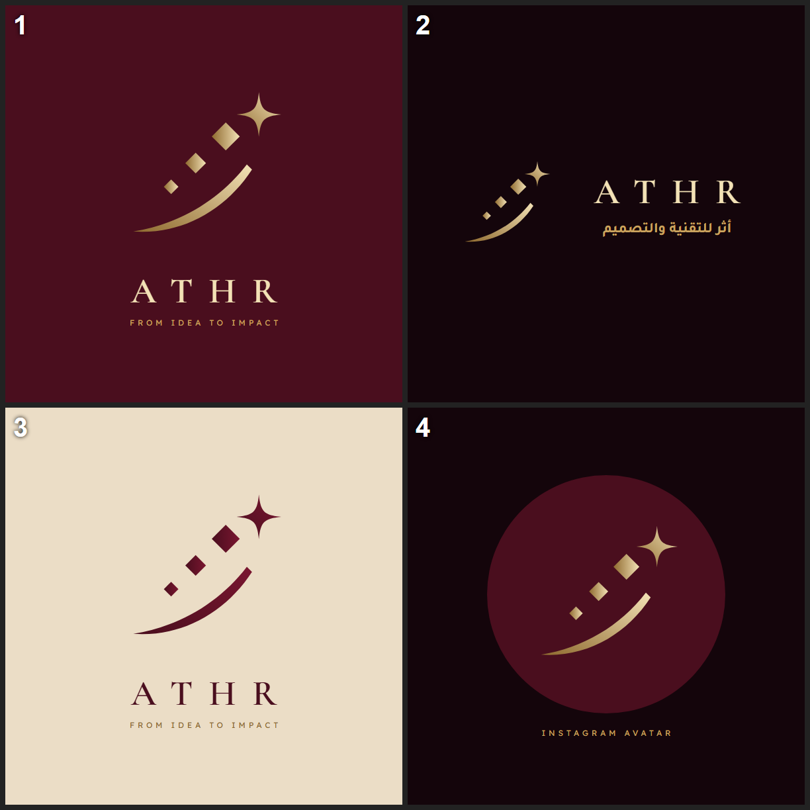

# رمز «الأثر» — قصة الرمز

> **نبتكر لنترك أثرًا — INNOVATE TO MAKE AN IMPACT**

## الفكرة

رمز أثر يُقرأ من الأسفل إلى الأعلى، كرحلة كل مشروع نعمل عليه:

| العنصر | الشكل | المعنى |
|---|---|---|
| **الضربة المنحنية** | خط ذهبي ينحني صاعداً من أسفل اليسار | **الأثر** الذي يبقى بعد الحركة، وضربة القلم العربي التي تُذكّر بالحرف |
| **الماسات الثلاث** | ثلاث ماسات تكبر تدريجياً وهي تصعد | **نقاط حرف الثاء** في «أثر»، وهي أيضاً **بكسلات** رقمية: الفكرة تبدأ صغيرة وتنمو خطوة بخطوة |
| **الشرارة الرباعية** | نجمة بأربعة أطراف في القمة | **الأثر والنتيجة**: لحظة الإطلاق التي تلمع فيها الفكرة وتصبح واقعاً |

## الرسالة

الرمز كله يحكي السلوجن من غير كلمات:
**فكرة صغيرة ← تنمو بالتقنية والتصميم ← تصل إلى أثر يلمع ويبقى.**

- **الاتجاه الصاعد (↗):** طموح ونمو وحركة إلى الأمام.
- **الهندسة الدقيقة (الماسات والزوايا):** التقنية والانضباط.
- **الانحناء الناعم:** التصميم والجمال والإحساس.
- **الذهبي على العنابي:** الفخامة والثقة والجذور الخليجية.

## الألوان

| الاسم | الكود | الاستخدام |
|---|---|---|
| ذهبي فاتح | `#F3E2B6` | قمة التدرج والشرارة |
| ذهبي | `#C9A35F` | اللون الرئيسي للرمز |
| ذهبي داكن | `#8F6A2F` | بداية التدرج من أسفل |
| عنابي | `#4A0E1E` | الخلفية الرئيسية |
| ليلي | `#14050B` | الخلفية الداكنة |
| بيج | `#EBDDC6` | خلفية الطباعة |

التدرج يسير دائماً **من الداكن في الأسفل إلى الفاتح في الأعلى**، رمزًا للصعود والنمو.

## الملفات

| الملف | الاستخدام |
|---|---|
| `athr-symbol-gold.svg` | الرمز الذهبي بخلفية شفافة (على الخلفيات الداكنة) |
| `athr-symbol-maroon.svg` | الرمز العنابي بخلفية شفافة (على البيج والأبيض) |
| `athr-symbol-on-maroon.svg` | الرمز على مربع عنابي (أيقونة التطبيق والموقع) |
| `athr-symbol-avatar.svg` | الرمز داخل دائرة عنابية (صورة حسابات التواصل) |

## قواعد الاستخدام

- لا يُدار الرمز ولا يُعكس، فاتجاهه الصاعد إلى اليمين جزء من معناه.
- لا تُغيَّر نسب الماسات الثلاث ولا عددها.
- يُترك حول الرمز فراغ لا يقل عن عرض الشرارة من كل جهة.
- أصغر مقاس: 24px على الشاشة و8mm في الطباعة.

## الحركة (للموقع والريلز)

1. ترسم الضربة نفسها من أسفل اليسار إلى أعلى.
2. تظهر الماسات واحدة بعد الأخرى من الأصغر إلى الأكبر.
3. تلمع الشرارة في القمة.

مدة الحركة كاملة نحو 1.2 ثانية.
